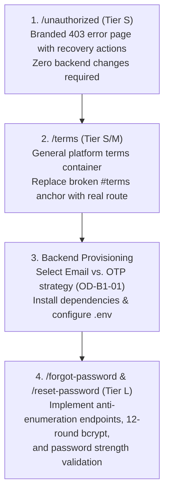

# Batch 1 Analysis Summary: Legacy Page Briefs

> **DOCUMENT TYPE**: Architectural Synthesis & Decision Matrix (Batch 1)  
> **PAGES ANALYZED**: `/forgot-password`, `/reset-password`, `/unauthorized`, `/terms`  
> **AUDIT DATE**: 2026-10-05  
> **GOVERNING DIRECTIVE**: [System Directive v2.0](file:///d:/Ods%20Global/Source%20Code/Ods-Global-Network/System%20Directive/ODS-Global-Network%E2%80%94System_Directive_v2.0_%28Baseline+Changes%29.md)

---

### 1. Page Matrix

| Route | Scope Section | Suggested Bucket | Main Risk / Architecture Note |
| :--- | :--- | :--- | :--- |
| **`/forgot-password`** | **Section 3** (Customer Portal) & **Section 10** (Security) | **Adapt** | **User Enumeration & Flooding**: Legacy backend returns 404 `"Email not found"` and lacks rate limiting. Backend currently has zero email delivery capability. |
| **`/reset-password`** | **Section 3** (Customer Portal) & **Section 10** (Security) | **Adapt** | **Token Exposure & Weak Crypto**: Token passed in URL query param (`?token=`), 10-round bcrypt hash (violates §8 mandate of 12 rounds), no password confirmation field or strength validation. |
| **`/unauthorized`** | **Section 10** (Security / RBAC) | **Adapt** (or embed as error state) | **Dead-End UX**: Bare screen with zero recovery navigation, no return to dashboard button, and no brand styling. Traps legitimate users. |
| **`/terms`** | **Section 1** (Website Completion) & **Section 12** (Documentation) | **Adapt** | **Outdated Gifting Scope & Typo**: Restricts ODS to a gifting store, omits healthcare/merchant terms, and lists an erroneous email (`support@odsglobal.net.com`). |

---

### 2. Backend Email Dispatch Capability Audit

#### Can `./Backend` Send Email Today?
> 🛑 **NO.** The current active backend workspace (`./Backend`) has **zero email-sending infrastructure** configured.

#### What Is Missing:
1. **Mailer Dependency**: Neither `nodemailer`, `@sendgrid/mail`, `resend`, nor any SMTP communication library is installed in [`Backend/package.json`](file:///d:/Ods%20Global/Source%20Code/Ods-Global-Network/Backend/package.json).
2. **Environment Configuration**: No SMTP credentials (`SMTP_HOST`, `SMTP_PORT`, `SMTP_USER`, `SMTP_PASS`, `FROM_EMAIL`, or API keys) exist in [`Backend/.env.example`](file:///d:/Ods%20Global/Source%20Code/Ods-Global-Network/Backend/.env.example).
3. **Mailer Utility / Service**: There is no mailer module, transport pool, or notification dispatcher anywhere in [`Backend/src/`](file:///d:/Ods%20Global/Source%20Code/Ods-Global-Network/Backend/src/).
4. **Email Templates**: No transactional HTML or plain-text email templates exist for password reset, email verification, or system notices.
5. **Asynchronous Handling / Retries**: No background queue or retry mechanism exists for managing mail gateway network timeouts or failures.

#### Database Contrast (Ready for OTPs):
While email is not wired, the PostgreSQL database **already has a dedicated OTP table**:
- [`Backend/src/database/migrations/008_create_otp_codes_table.sql`](file:///d:/Ods%20Global/Source%20Code/Ods-Global-Network/Backend/src/database/migrations/008_create_otp_codes_table.sql) defines `otp_codes` with columns `id`, `user_id`, `code_hash`, `purpose`, `expires_at`, and `verified_at`.
- This schema is immediately ready to store hashed one-time recovery codes (e.g. 6-digit codes sent via SMS or email) with cryptographically secure time bounds.

---

### 3. Terms & Conditions: Clause Categorization & Legal Notice

> [!IMPORTANT]  
> **Mandatory Legal Review**: The clauses below represent legacy text extracted from `./resource`. All final terms of service must undergo professional legal counsel review before launch.

#### A. Generic Clauses (Reusable After Legal Review)
- **Acceptance Preamble**: Using the digital platform constitutes legal agreement to the terms.
- **Payment Verification Requirement**: Services, vouchers, and bookings are only confirmed upon cryptographic settlement; unverified/failed transactions are void.
- **Limitation of Third-Party Liability**: ODS Global Network is not liable for upstream/downstream network delays, third-party payment gateway downtime, or independent delivery issues.
- **Support & Complaints Contact**: Standard mechanism directing users to formal contact channels (corrected to official `info@odsglobal.net`).

#### B. Gifting- or Wanaw-Specific Clauses (Not Reusable for General Platform Terms)
- **Narrow Gifting Scope Definition**: Describing ODS Global Network exclusively as a "curated gifting" platform, which conflicts with the multi-sector healthcare, diagnostics, and merchant ecosystem.
- **Giver & Receiver Catalogs**: Classifying all system users into "Gift Givers" and "Gift Receivers".
- **Holiday & Occasion Lists**: Hard-coding specific Ethiopian cultural holidays, festivals, and specific products (e.g. "Branded Chocolate Gifts"). These belong in marketing collateral or a dedicated Gifting Policy Addendum.
- **Single-Processor Reference**: Naming Chapa exclusively while ignoring the 5 required payment methods in Scope Section 6 (Cards, Mobile Money, Bank Transfer, Digital Wallets).

---

### 4. Shared Architectural Findings Across Batch 1

1. **Brand Drift in Legacy Assets**:
   - The legacy components rely on hard-coded Tailwind hex codes (`#1c2b21` dark green, `#D4AF37` pale gold) and legacy raster logos (`/wanaw gifting logo.jpeg`).
   - The modern build uses official CSS variables (`--color-navy: #0F285B`, `--color-gold: #BE9B49`) and clean SVG vector assets from `./Assets/brand/vector/`.
2. **Fragile Form Error Handling**:
   - Both `/forgot-password` and `/reset-password` lack disabled states and loading indicators during submission, leaving forms vulnerable to rapid duplicate submissions.
   - `/reset-password` renders server error messages inside green success text elements.
3. **Absence of Rate Limiting & User Privacy**:
   - The legacy password reset workflow exposes whether an email address is registered, enabling automated account enumeration.
   - The password reset token is passed directly in the URL search query, violating the zero-token exposure mandate in System Directive §8.

---

### 5. Open Decisions for the Human Owner

| Decision ID | Topic | Options | Recommendation |
| :--- | :--- | :--- | :--- |
| **OD-B1-01** | **Recovery Mechanism** | **Option A**: Magic reset link via email (requires adding an SMTP provider like Nodemailer/SendGrid/Resend). **Option B**: Time-limited 6-digit OTP code using existing `otp_codes` table via SMS or email. **Option C**: Support both (SMS OTP + Emailed reset link). | **Option B** as initial MVP using `otp_codes` (aligned with existing DB schema), expanding to **Option C** when external email and SMS gateways are provisioned. |
| **OD-B1-02** | **Account Enumeration Response** | **Option A**: Return `"If an account exists with this email, a reset code has been sent"` for all inputs (Secure, prevents enumeration). **Option B**: Return 404 `"Email not found"` (Legacy behavior, high security risk). | **Option A** (Mandatory per Directive §8/§17 & Scope Section 10). |
| **OD-B1-03** | **Unauthorized (`403`) Presentation** | **Option A**: Dedicated `/unauthorized` standalone page with return buttons. **Option B**: Dynamic in-dashboard error card / banner when unauthorized routes are requested. **Option C**: Maintain current modern behavior (silent redirect to assigned role dashboard). | **Option A**: Dedicated branded error view with explicit "Return to Dashboard" and "Sign Out" actions to give clear feedback. |
| **OD-B1-04** | **Scope of Terms & Conditions** | **Option A**: Comprehensive master Platform Terms covering Healthcare, Providers, Merchants, Bookings, and Gifting. **Option B**: General Platform Terms now, with separate Gifting & Provider Terms as secondary addenda. | **Option B**: Draft clean, modern general platform terms now; add specialized medical and merchant addenda before pilot launch. |

---

### 6. Recommended Implementation Sequence

1. **Step 1: `/unauthorized` (Tier S — Fast win)**:
   - Standalone polished 403 page with official deep navy theme, shield/lock icon from `lucide-react`, and action buttons (`Return to Dashboard`, `Sign Out`).
2. **Step 2: `/terms` (Tier S/M — Compliance)**:
   - Modern, readable legal page with brand typography, clean layout, and general platform terms separated from legacy gifting copy. Resolves footer dead anchor.
3. **Step 3: Backend Gateway Resolution**:
   - Resolve **OD-B1-01** (Email vs. OTP). Add needed transport library and environment variables.
4. **Step 4: `/forgot-password` & `/reset-password` (Tier L — High Security)**:
   - Full end-to-end implementation with anti-enumeration protection, rate limiting, 12-round bcrypt hashing, password confirmation, and live strength meter.
