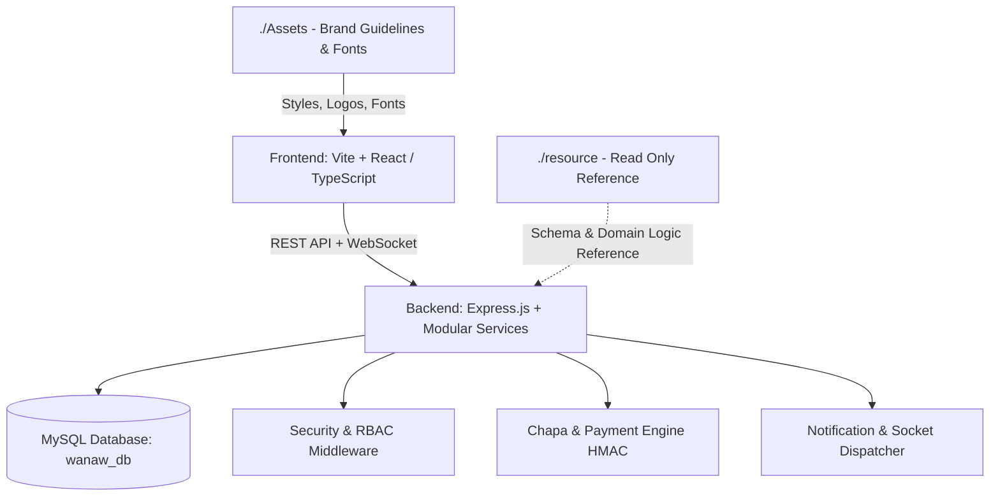

# ODS Global Network — Master Implementation Plan

> **DERIVED FROM**: `./System Directive/SYSTEM_DIRECTIVE.md` & Project KPIs  
> **WORKSPACE**: `./Progress` (all outputs & roadmaps stored here)  
> **SCOPE**: End-to-End Platform Architecture & Scaffolding (`./Frontend` & `./Backend`)  
> **STATUS**: READY FOR PHASE 1 SCAFFOLDING  

---

## 1. Architectural Blueprint

---

## 2. Phased Execution Roadmap

### Phase 1: Project Foundation & Baseline Scaffolding
- [ ] Initialize clean `./Frontend` with modern React + TypeScript + Vite, using `./Assets/fonts` (`Google Sans Flex` and `Inter`) and ODS luxury Royal Navy (`#0F285B`), Forest Green (`#1C2B21`), and Metallic Gold tokens.
- [ ] Initialize clean `./Backend` with structured Express architecture (MVC + Services, clean routing, error handling, rate limiting).
- [ ] Configure unified root tooling in `./package.json` to build and run both workspaces seamlessly.
- [ ] Validate base connectivity between `./Frontend` and `./Backend`.

### Phase 2: Security, Auth & RBAC Core
- [ ] Implement robust token-based authentication (JWT in secure cookies / safe header handling, no tokens in query params).
- [ ] Implement role-based authorization: `super_admin`, `admin`, `merchant`, `service_provider`, `customer`.
- [ ] Establish audit logging and input validation middleware.
- [ ] Implement password hashing with `bcryptjs` (12 rounds minimum).

### Phase 3: Service Provider & Merchant Workflows (Non-CRUD)
- [ ] Merchant registration with multi-stage verification (document upload, status progression: `PENDING` → `APPROVED` → `ACTIVE`).
- [ ] Provider category discovery (Hospitals, Clinics, Pharmacies, Labs, Wellness Centers, Ambulances, Home Care).
- [ ] Provider availability scheduling engine.

### Phase 4: Customer Portal & Appointment Booking Engine
- [ ] Interactive service catalog and provider directory.
- [ ] Stateful appointment booking engine with slot reservation lock and conflict detection.
- [ ] Real-time appointment status updates via WebSockets.

### Phase 5: Payment Gateway & Gift Card Engine
- [ ] Chapa payment gateway integration with cryptographic HMAC webhook verification.
- [ ] Digital gift card issuance, ledger balance tracking, and secure redemption code validation.
- [ ] Financial transaction logging and receipt generation.

### Phase 6: Executive Admin Dashboard & Analytics
- [ ] Comprehensive management consoles for Super Admins and Operations.
- [ ] Live analytics: active users, transaction volume, booking completion rates, provider onboarding metrics.
- [ ] Audit logs and platform performance metrics.
