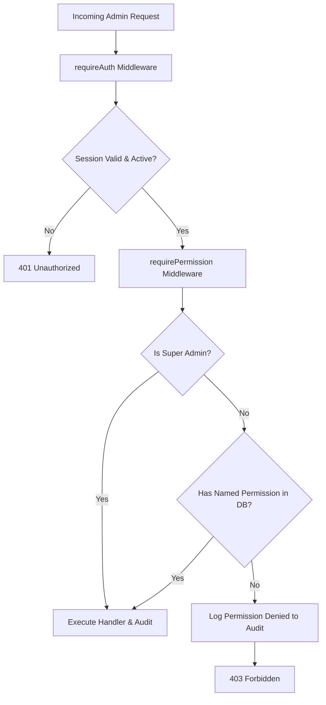

# Implementation Plan — Batch 10: Full Admin Console

**Document Reference**: `Progress/2026-10-26_1530_implementation-plan_batch10-full-admin-console.md`  
**Created**: 2026-10-26  
**Status**: Proposed scope, for review before execution  
**Depends on**: Batch 4 (KYC documents, thin admin slice), Batch 5 (token_version session invalidation, email verification), Batch 6 (payments ledger), Batch 7 (gifts), Batch 8 (service catalog and moderation), Batch 9 (bookings)  
**Feeds into**: Batch 11 (admin-triggered notifications, template management), Batch 12 (security review, go-live gate)  

---

## 1. Executive Summary & Purpose

Batch 10 transforms the initial thin admin slice into the **operational control center** of the ODS Global Network platform. Across Batches 4 through 9, the platform accumulated users, providers, KYC verification documents, payments, gift cards, service catalog items, and appointment bookings. Platform administrators require a centralized, secure, and auditable console to inspect, intervene, moderate, and report.

Because this console provides the most powerful administrative capabilities in the platform, its architecture is centered around four zero-trust pillars:
1. **Granular Role-Based Permissions**: Replacing the coarse "admin sees everything" model with named permission checks enforced on the server for every endpoint.
2. **Immediate Revocation**: Database-backed permission resolution on each request combined with `token_version` bumping ensures suspension and permission revocations take effect instantly, rather than waiting for 24-hour JWT sessions to expire.
3. **Atomic Append-Only Audit Logging**: Every state-changing admin action writes an audit row inside the **same database transaction** as the mutation. If the audit insert fails, the action rolls back.
4. **Least-Privilege & Privacy Enforcement**: Application runtime role (`ods_app`) is strictly denied `UPDATE`, `DELETE`, or `TRUNCATE` privileges on the `admin_audit_log` table. Admin endpoints never expose password hashes, tokens, or unmasked sensitive secrets.

---

## 2. Scope Traceability: Goals & Non-Goals

### Goals
- **Granular RBAC Architecture**: Permission-based authorization with 7 operational groups: Support, Compliance, Catalog Moderation, Finance, Operations, User Admin, and System.
- **Unified Operational Dashboard**: Real-time KPI counters (new users, pending KYC, services pending review, bookings today, revenue today, payment conflicts, expiring gifts) and a "Needs Attention" queue tailored to the viewer's active permissions.
- **User Management**: Search, inspection, user profile overview, suspension/reactivation (with mandatory reason), global session termination (force sign-out via `token_version`), password reset dispatch, restricted email verification override, and internal administrative notes.
- **Merchant & Provider KYC Intake**: Multi-document verification queue (enforcing business registration AND license documents), secure document streaming (no public URLs), approve/reject/request-info decisions with reasons.
- **Service Catalog Moderation**: Moderate services across 7 states, takedown with future booking conflict alerts, and 2-level category taxonomy editing.
- **Booking Oversight & Conflict Resolution**: Searchable bookings ledger, admin cancellation with refund calculations/overrides, payment conflict resolution, and lightweight dispute flagging.
- **Finance, Transactions & Refund Approvals**: Financial transaction ledger, reconciliation monitor (detecting payment/booking mismatches), provider earnings owed, manual refund requests with two-person approval for amounts over 10,000 ETB, and permission-gated CSV exports.
- **Gift Card Management**: Inspection of digital vouchers, balance adjustment, cancellation with customer refund, expiry extension, and logged unmasking of redemption codes.
- **Append-Only Audit Log**: Transactional recording of actor, permission, action, target entity, before/after diff summary, client IP, user agent, and timestamp.
- **Standard Reports**: 6 core operational reports (Users, Onboarding Funnel, Catalog Taxonomy, Bookings, Revenue & Refunds, Top Providers) with date filters and CSV export.
- **Admin Account Management & Platform Settings**: Super-admin controlled staff account provisioning, permission assignment, step-up re-authentication on dangerous operations, and typed platform settings store.

### Non-Goals (Strictly Deferred)
- **Email Notification Sending & Template Editing** (Deferred to Batch 11; Batch 10 provides a read-only list of active system templates).
- **Automated Payout Disbursement** (Deferred to Batch 12; Batch 10 provides read-only tracking of provider earnings owed).
- **Customer Support Ticketing / Live Chat** (Out of platform scope).
- **Advanced BI Data Warehousing** (Out of platform scope).
- **Production Infrastructure Monitoring & Alerting** (Batch 12).
- **Multi-Language Admin Localization** (English-only admin console).

---

## 3. Open Decisions & Recommendations

The Batch 10 specification identifies 14 open architectural and operational decisions. Below are the recommended approaches for each:

| # | Decision Topic | Recommended Approach | Rationale |
| :- | :--- | :--- | :--- |
| **D1** | **Permission Model** | **Predefined Role Groups + Granular Permissions** | Staff are assigned to one or more predefined groups (`Support`, `Compliance`, `Catalog`, `Finance`, `Operations`, `UserAdmin`, `System`), granting a bundle of granular permissions. Direct single-permission overrides are supported for edge cases. |
| **D2** | **Immediate Revocation** | **Per-Request DB Permission Check + `token_version`** | In `sessionService.js`, `resolveSession` already queries PostgreSQL fresh on each request. We join admin permissions in the same query. Permission revocations take effect on the very next HTTP request without relying on distributed cache invalidation. |
| **D3** | **Step-Up Authentication** | **Password Re-entry for High-Risk Actions** | Required for: (1) Changing user roles (e.g. promoting to admin), (2) Assigning/revoking admin permissions, (3) Approving refunds > 10,000 ETB, and (4) Exporting customer PII. Client submits current admin password in payload; verified server-side via `bcrypt.compare`. |
| **D4** | **Two-Factor Authentication (2FA)** | **Deferred to Batch 12 (Go-Live Gate)** | Keeps Batch 10 focused on admin functionality; 2FA module will be introduced during platform-wide security hardening in Batch 12. |
| **D5** | **Two-Person Refund Approval** | **Enforced for Refunds > 10,000 ETB** | Refunds ≤ 10,000 ETB require single Finance admin approval. Refunds > 10,000 ETB enter `pending_second_approval` in `refund_approvals` table, requiring a different admin with `finance.refund_approve` or `super_admin`. |
| **D6** | **KYC Strictness** | **Require Both Registration & License Documents** | Closes Batch 4 follow-up. Approval requires at least 1 document with `purpose = 'business_registration'` AND at least 1 document with `purpose = 'license'`. Super admin can override with mandatory logged justification. |
| **D7** | **Provider Suspension Effects** | **Auto-Unpublish Services; Hold Bookings for Review** | When a provider is suspended: all their published services automatically transition to `unpublished` with status history note `"Provider suspended"`. Future confirmed bookings remain active and appear in Admin "Needs Attention" queue for case-by-case resolution. |
| **D8** | **Service Takedown with Future Bookings** | **Warning Dialog; Bookings Remain Valid** | Takedown modal warns the admin with the exact count of upcoming bookings. Bookings remain valid unless explicitly cancelled by admin or provider. |
| **D9** | **Gift Code Unmasking** | **Masked by Default; Logged Unmask Action** | Codes display as `ODS-GC-****-****-1234`. Only admins with `gifts.reveal_code` or `super_admin` can call `POST /api/admin/gifts/:id/reveal-code`, which returns the code and writes a high-priority audit log entry. |
| **D10** | **Operational Reports Scope** | **6 Standard Reports for Launch** | (1) User Registrations, (2) KYC Onboarding Funnel, (3) Services Catalog Breakdown, (4) Booking Volume & Cancellation Rates, (5) Revenue, Refunds & Net Volume, (6) Top Healthcare Providers. |
| **D11** | **Data Export Restrictions** | **Aggregates & Financials Allowed; PII Restricted** | Financial transactions, refunds, and operational aggregates can be exported by Finance/Operations roles. Customer PII export is restricted strictly to `super_admin` with logged audit record. |
| **D12** | **Platform Settings Store** | **Typed Key-Value Store (`platform_settings`)** | Controls operational parameters: `booking_hold_duration_minutes` (default 10), `booking_max_advance_days` (default 60), `gift_voucher_validity_days` (default 365), `refund_two_person_threshold_etb` (default 10000). Secrets remain strictly in `.env`. |
| **D13** | **Admin Account Provisioning** | **Super Admin Creates Account with Temporary Password** | Super admin provisions account with email, name, role groups, and temporary password. User is flagged with `must_change_password = true`, requiring immediate password update on first login. |
| **D14** | **Audit Log Retention** | **Indefinite Retention (Append-Only)** | All records preserved indefinitely for regulatory and compliance auditability. Database permissions ensure `ods_app` cannot modify or delete audit rows. |

---

## 4. Architectural & Permission Blueprint

### 4.1 RBAC Permission Hierarchy
Every admin request must pass two checks:
1. `requireAuth`: Validates `ods_session` cookie, verifies `token_version`, checks `is_active = true`.
2. `requirePermission(permissionKey)`: Validates that the user's role is `super_admin` (which inherits all permissions) OR the user possesses the specific named permission via their assigned groups or explicit grants.



### 4.2 Permission Groups & Keys Matrix

| Permission Group | Code Key Prefix | Granular Permission Keys |
| :--- | :--- | :--- |
| **Support** | `support.*` | `users.view`, `bookings.view`, `gifts.view`, `payments.view`, `users.notes_add` |
| **Compliance** | `compliance.*` | `kyc.queue_view`, `kyc.document_view`, `kyc.decide`, `providers.review` |
| **Catalog Moderation** | `catalog.*` | `services.view`, `services.moderate`, `categories.manage` |
| **Finance** | `finance.*` | `payments.view_ledger`, `refunds.initiate`, `refunds.approve`, `reports.financial_export` |
| **Operations** | `operations.*` | `bookings.manage`, `bookings.cancel_override`, `bookings.resolve_conflict`, `gifts.manage`, `gifts.reveal_code` |
| **User Administration** | `user_admin.*` | `users.manage`, `users.suspend`, `users.force_signout`, `users.reset_password`, `users.change_role` |
| **System** | `system.*` | `admins.manage`, `settings.manage`, `audit.view` |

### 4.3 Atomic Audit Logging Helper
The audit logging utility `logAdminAction(client, { actorUserId, permissionKey, action, targetType, targetId, summary, reason, req })` is executed within the **same SQL transaction** (`client`) as the domain action:
- Captures client IP (`req.ip` or `x-forwarded-for`), `user-agent`, actor user ID, permission used, target entity UUID, and sanitized summary diff.
- Guarantees zero "unlogged mutations": if logging fails, the transaction rolls back.

---

## 5. Database Schema & Migration Plan (`Migration 022`)

Migration file: `Backend/src/database/migrations/022_create_admin_console_tables.sql`  
Rollback file: `Backend/src/database/rollbacks/rollback_022.sql`

```sql
-- 1. admin_permissions: master catalog of granular permissions
CREATE TABLE IF NOT EXISTS admin_permissions (
    id UUID PRIMARY KEY DEFAULT gen_random_uuid(),
    key VARCHAR(64) UNIQUE NOT NULL,
    category VARCHAR(32) NOT NULL,
    description TEXT NOT NULL,
    created_at TIMESTAMPTZ NOT NULL DEFAULT NOW()
);

-- 2. admin_permission_groups: predefined roles (Support, Compliance, etc.)
CREATE TABLE IF NOT EXISTS admin_permission_groups (
    id UUID PRIMARY KEY DEFAULT gen_random_uuid(),
    name VARCHAR(64) UNIQUE NOT NULL,
    description TEXT NOT NULL,
    created_at TIMESTAMPTZ NOT NULL DEFAULT NOW()
);

-- 3. admin_group_permissions: junction between groups and permission keys
CREATE TABLE IF NOT EXISTS admin_group_permissions (
    group_id UUID NOT NULL REFERENCES admin_permission_groups(id) ON DELETE CASCADE,
    permission_id UUID NOT NULL REFERENCES admin_permissions(id) ON DELETE CASCADE,
    PRIMARY KEY (group_id, permission_id)
);

-- 4. admin_user_groups: assigned groups per admin user
CREATE TABLE IF NOT EXISTS admin_user_groups (
    user_id UUID NOT NULL REFERENCES users(id) ON DELETE CASCADE,
    group_id UUID NOT NULL REFERENCES admin_permission_groups(id) ON DELETE CASCADE,
    assigned_by UUID REFERENCES users(id) ON DELETE SET NULL,
    assigned_at TIMESTAMPTZ NOT NULL DEFAULT NOW(),
    PRIMARY KEY (user_id, group_id)
);

-- 5. admin_user_permissions: optional direct grant/deny overrides
CREATE TABLE IF NOT EXISTS admin_user_permissions (
    user_id UUID NOT NULL REFERENCES users(id) ON DELETE CASCADE,
    permission_id UUID NOT NULL REFERENCES admin_permissions(id) ON DELETE CASCADE,
    is_granted BOOLEAN NOT NULL DEFAULT TRUE,
    granted_by UUID REFERENCES users(id) ON DELETE SET NULL,
    granted_at TIMESTAMPTZ NOT NULL DEFAULT NOW(),
    PRIMARY KEY (user_id, permission_id)
);

-- 6. admin_audit_log: append-only immutable audit trail
CREATE TABLE IF NOT EXISTS admin_audit_log (
    id UUID PRIMARY KEY DEFAULT gen_random_uuid(),
    actor_user_id UUID REFERENCES users(id) ON DELETE SET NULL,
    permission_key VARCHAR(64) NOT NULL,
    action VARCHAR(64) NOT NULL,
    target_type VARCHAR(64) NOT NULL,
    target_id VARCHAR(64) NOT NULL,
    summary JSONB NOT NULL DEFAULT '{}'::jsonb,
    reason TEXT,
    ip_address VARCHAR(45),
    user_agent TEXT,
    created_at TIMESTAMPTZ NOT NULL DEFAULT NOW()
);

-- 7. user_admin_notes: internal notes on users/providers
CREATE TABLE IF NOT EXISTS user_admin_notes (
    id UUID PRIMARY KEY DEFAULT gen_random_uuid(),
    user_id UUID NOT NULL REFERENCES users(id) ON DELETE CASCADE,
    author_user_id UUID NOT NULL REFERENCES users(id) ON DELETE CASCADE,
    note TEXT NOT NULL,
    created_at TIMESTAMPTZ NOT NULL DEFAULT NOW()
);

-- 8. refund_approvals: two-person approval workflow for large refunds
CREATE TABLE IF NOT EXISTS refund_approvals (
    id UUID PRIMARY KEY DEFAULT gen_random_uuid(),
    transaction_id UUID NOT NULL REFERENCES transactions(id) ON DELETE RESTRICT,
    booking_id UUID REFERENCES bookings(id) ON DELETE RESTRICT,
    amount NUMERIC(12,2) NOT NULL,
    currency VARCHAR(3) NOT NULL DEFAULT 'ETB',
    status VARCHAR(30) NOT NULL DEFAULT 'pending_approval', -- pending_approval, approved, rejected
    requested_by UUID NOT NULL REFERENCES users(id) ON DELETE RESTRICT,
    approved_by UUID REFERENCES users(id) ON DELETE RESTRICT,
    request_reason TEXT NOT NULL,
    decision_reason TEXT,
    created_at TIMESTAMPTZ NOT NULL DEFAULT NOW(),
    decided_at TIMESTAMPTZ
);

-- 9. platform_settings: typed configuration key-value store
CREATE TABLE IF NOT EXISTS platform_settings (
    key VARCHAR(64) PRIMARY KEY,
    value JSONB NOT NULL,
    value_type VARCHAR(20) NOT NULL, -- integer, string, boolean, json
    description TEXT,
    updated_by UUID REFERENCES users(id) ON DELETE SET NULL,
    updated_at TIMESTAMPTZ NOT NULL DEFAULT NOW()
);

-- Add must_change_password column to users table if not exists
ALTER TABLE users ADD COLUMN IF NOT EXISTS must_change_password BOOLEAN NOT NULL DEFAULT FALSE;

-- Indexes for performant list and audit queries
CREATE INDEX IF NOT EXISTS idx_admin_audit_actor_created ON admin_audit_log(actor_user_id, created_at DESC);
CREATE INDEX IF NOT EXISTS idx_admin_audit_target ON admin_audit_log(target_type, target_id);
CREATE INDEX IF NOT EXISTS idx_admin_audit_action_created ON admin_audit_log(action, created_at DESC);
CREATE INDEX IF NOT EXISTS idx_user_admin_notes_user ON user_admin_notes(user_id, created_at DESC);
CREATE INDEX IF NOT EXISTS idx_refund_approvals_status ON refund_approvals(status);

-- Least-Privilege Grants to ods_app runtime role
GRANT SELECT, INSERT, UPDATE, DELETE ON admin_permissions, admin_permission_groups, admin_group_permissions, admin_user_groups, admin_user_permissions, user_admin_notes, refund_approvals, platform_settings TO ods_app;
GRANT SELECT, INSERT ON admin_audit_log TO ods_app;
REVOKE UPDATE, DELETE, TRUNCATE ON admin_audit_log FROM ods_app;
```

---

## 6. API Surface Specification (`/api/admin/...`)

All routes require `requireAuth` + `requirePermission(permissionKey)`:

### 6.1 Dashboard & Metrics
- `GET /api/admin/dashboard`: Returns aggregate counters (`new_users_count`, `pending_kyc_count`, `pending_services_count`, `today_bookings_count`, `today_revenue_amount`, `payment_conflicts_count`, `expiring_gifts_count`) filtered by viewer's active permissions. Includes `needs_attention` queue array.

### 6.2 User Administration
- `GET /api/admin/users`: Paginated search with filters (`search`, `role`, `status`, `from_date`, `to_date`, `page`, `limit`).
- `GET /api/admin/users/:id`: Detailed view including profile, KYC status, bookings summary, payments history, admin notes, and audit history.
- `POST /api/admin/users/:id/suspend`: Suspends user (`is_active = false`), requires `reason`. Atomically bumps `token_version` to invalidate all active sessions immediately. If provider, auto-unpublishes their services.
- `POST /api/admin/users/:id/reactivate`: Restores account (`is_active = true`), requires `reason`.
- `POST /api/admin/users/:id/force-signout`: Atomically increments `token_version`, invalidating all active sessions across devices.
- `POST /api/admin/users/:id/notes`: Adds internal administrative note (`user_admin_notes`).
- `POST /api/admin/users/:id/change-role`: Requires `super_admin` + step-up password verification. Prevents self-role demotion and prevents removing the last super admin.

### 6.3 Onboarding & KYC Management
- `GET /api/admin/kyc/queue`: Extends Batch 4 queue with filter tabs (`pending`, `needs_info`, `approved`, `rejected`), document counts, and application dates.
- `GET /api/admin/kyc/:entityType/:id`: Detailed applicant review with linked uploaded documents.
- `GET /api/admin/kyc/documents/:docId/view`: Securely streams file with proper `Content-Type` and security headers (`X-Content-Type-Options: nosniff`).
- `POST /api/admin/kyc/:entityType/:id/decision`: Decision endpoint with mandatory validation:
  - If approving: Enforces presence of both `business_registration` AND `license` documents.
  - If rejecting: Requires `reason`.
  - If requesting info: Requires `request_message`. Emits outbox event for Batch 11.

### 6.4 Service Moderation & Categories
- `GET /api/admin/services`: Full catalog list with filters (`status`, `category_id`, `provider_id`, `search`, `page`).
- `POST /api/admin/services/:id/decision`: Approve or reject (`reason` required).
- `POST /api/admin/services/:id/takedown`: Admin takedown. Returns count of upcoming confirmed bookings as impact summary.
- `POST /api/admin/services/:id/restore`: Restores taken-down service back to `published`.
- `GET /api/admin/categories`: Full category taxonomy tree.
- `POST /api/admin/categories`: Create category (name, parent_id, slug, sort_order).
- `PUT /api/admin/categories/:id`: Update category details or active status.

### 6.5 Booking Oversight
- `GET /api/admin/bookings`: Platform-wide searchable booking list (`reference`, `customer_id`, `provider_id`, `status`, `from_date`, `to_date`).
- `GET /api/admin/bookings/:id`: Comprehensive booking detail with status timeline (`booking_status_history`), payment record, and customer note.
- `POST /api/admin/bookings/:id/cancel`: Admin cancellation. Calculates refund amount based on policy or accepts explicit refund override (requires `finance.refund_override` permission + reason).
- `POST /api/admin/bookings/:id/resolve-conflict`: Resolves late-payment conflict bookings (`payment_conflict`), either confirming to a newly opened slot or triggering a full refund.
- `PATCH /api/admin/bookings/:id/dispute`: Flags booking as disputed with administrative notes.

### 6.6 Finance, Transactions & Refunds
- `GET /api/admin/transactions`: Financial ledger list with filters (`status`, `purpose`, `tx_ref`, `min_amount`, `max_amount`, `date_range`).
- `GET /api/admin/reconciliation`: Reconciles transactions against bookings and gifts; flags unconfirmed paid transactions and orphaned webhooks.
- `GET /api/admin/earnings`: Read-only summary of provider balances and earnings owed.
- `POST /api/admin/refunds`: Initiates a refund. If `amount > 10,000 ETB`, creates a `refund_approvals` entry; if `amount <= 10,000 ETB`, executes immediately.
- `POST /api/admin/refunds/:id/approve`: Approves a pending large refund. Enforces that the approver is different from the requester (two-person rule).

### 6.7 Gift Card Management
- `GET /api/admin/gifts`: Searchable gift card list with masked redemption codes (`ODS-GC-****-****-1234`).
- `GET /api/admin/gifts/:id`: Gift card detail with status history and balance.
- `POST /api/admin/gifts/:id/cancel`: Cancels unredeemed gift card and issues customer refund.
- `POST /api/admin/gifts/:id/extend`: Extends expiration date with reason.
- `POST /api/admin/gifts/:id/reveal-code`: Requires `operations.gift_reveal` permission. Logs high-priority audit entry and returns full unmasked code.

### 6.8 Audit Log & Reporting
- `GET /api/admin/audit-log`: Filterable audit ledger (`actor_id`, `action`, `target_type`, `date_range`, `page`).
- `GET /api/admin/reports/:name`: Returns JSON dataset for one of the 6 standard reports.
- `GET /api/admin/reports/:name/export`: Streams CSV export. Requires `reports.export` permission; logged in audit log.

### 6.9 Staff Accounts & Settings
- `GET /api/admin/staff`: Lists all administrative staff accounts, active groups, and last login dates.
- `POST /api/admin/staff`: Creates staff account with temporary password and assigns permission groups (requires `system.admins_manage` and step-up password).
- `PUT /api/admin/staff/:id/groups`: Updates staff member's assigned permission groups.
- `POST /api/admin/staff/:id/deactivate`: Deactivates staff account and bumps `token_version`.
- `GET /api/admin/settings`: Lists platform configuration settings.
- `PUT /api/admin/settings`: Updates setting value with validation and audit entry.
- `GET /api/admin/templates`: Read-only catalog of email notification templates (preparing for Batch 11).

---

## 7. Frontend Architecture & Modular Tabs

The frontend extends [AdminDashboard.tsx](file:///d:/Ods%20Global/Source%20Code/Ods-Global-Network/Frontend/src/pages/dashboards/AdminDashboard.tsx) using modular tabs dynamically filtered by the admin's permissions:

```text
Frontend/src/pages/dashboards/admin/
├── AdminOverviewTab.tsx          # Real-time KPI tiles & Needs Attention queue
├── UsersTab.tsx                  # User management, search, detail drawer, suspension modal
├── KycQueueTab.tsx               # (Enhanced) Multi-document review & decision modal
├── ServicesTab.tsx               # Service catalog moderation & category manager
├── BookingsTab.tsx               # Booking oversight, dispute flag & refund resolution
├── FinanceTab.tsx                # Transactions ledger, reconciliation & 2-person refund modal
├── GiftsTab.tsx                  # Gift card management with masked code reveal
├── AuditLogsTab.tsx              # (Enhanced) Full audit log viewer with actor/target filters
├── ReportsTab.tsx                # Standard reports charts & CSV export buttons
├── StaffAccountsTab.tsx          # Super-admin staff account provisioning & permission groups
└── PlatformSettingsTab.tsx       # Typed configuration editor with step-up confirmation
```

---

## 8. Execution Phases

### Phase 1: Foundations, Permissions Schema & Audit Middleware
- Create Migration `022_create_admin_console_tables.sql` and `rollback_022.sql`.
- Seed 7 default permission groups and ~30 granular permission keys.
- Implement permission middleware `requirePermission(permKey)` in `Backend/src/middleware/auth.js`.
- Implement transactional audit helper `logAdminAction` in `Backend/src/services/adminAuditService.js`.
- Apply migration and verify least-privilege grants (`ods_app` denied UPDATE/DELETE on audit table).

### Phase 2: User Administration Module
- Implement `/api/admin/users` routes in `Backend/src/routes/adminUsers.js`.
- Add suspension, reactivation, force sign-out (`token_version` bump), and internal notes.
- Implement super-admin role change with step-up password verification.

### Phase 3: Onboarding & KYC Strict Multi-Document Verification
- Upgrade KYC decision logic in `Backend/src/routes/admin.js`.
- Enforce requiring both business registration and license documents for approval.
- Add "Request More Info" action with message persistence.

### Phase 4: Service Catalog Moderation & Categories
- Implement catalog moderation and category taxonomy CRUD in `Backend/src/routes/adminServices.js`.
- Implement takedown with confirmed booking conflict detection.

### Phase 5: Booking Oversight & Conflict Resolution
- Implement `/api/admin/bookings` in `Backend/src/routes/adminBookings.js`.
- Support admin cancellation with policy refund calculation and explicit override.
- Support late-payment conflict resolution and dispute flagging.

### Phase 6: Finance, Transactions & Two-Person Refund Approvals
- Implement transactions list and reconciliation endpoints in `Backend/src/routes/adminFinance.js`.
- Implement `refund_approvals` table logic: automatic execution for ≤ 10,000 ETB; two-person approval for > 10,000 ETB.
- Implement provider earnings owed calculator.

### Phase 7: Gift Management & Logged Code Reveal
- Implement `/api/admin/gifts` in `Backend/src/routes/adminGifts.js`.
- Enforce masked redemption codes by default (`ODS-GC-****-****-1234`).
- Implement `POST /gifts/:id/reveal-code` with high-priority audit logging.

### Phase 8: Reporting Engine & Platform Settings
- Implement 6 standard operational reports in `Backend/src/services/reportService.js` and `/api/admin/reports`.
- Implement CSV streaming export with audit logging.
- Implement typed platform settings in `Backend/src/routes/adminSettings.js`.
- Expose read-only email templates list.

### Phase 9: Frontend Admin Console
- Implement typed client service `Frontend/src/services/adminConsoleService.ts`.
- Build modular admin tabs: `AdminOverviewTab`, `UsersTab`, `ServicesTab`, `BookingsTab`, `FinanceTab`, `GiftsTab`, `ReportsTab`, `StaffAccountsTab`, and `PlatformSettingsTab`.
- Wire permissions into navigation rendering and action buttons.

### Phase 10: Automated Testing & Regression
- Create `Backend/test-batch10-endpoints.js` covering all 10 test suites (T1 to T10).
- Run full regression suite across Batches 3 through 9.
- Verify Frontend TypeScript (`tsc --noEmit`) and production build (`npm run build`).

---

## 9. Verification Plan & Test Suite Matrix

| # | Check / Test Area | Command / Method | Expected Result | Status |
| :- | :--- | :--- | :--- | :--- |
| **V1** | Migration 022 | `node src/database/migrate.js status` | 022 applied cleanly | Pending |
| **V2** | Syntax Validation | `node --check` across all new backend files | Exit code 0, clean | Pending |
| **V3** | Batch 10 Test Suite | `$env:ALLOW_DESTRUCTIVE_TESTS=1; node test-batch10-endpoints.js` | All 10 suites pass (T1–T10) | Pending |
| **V4** | Permission Denial | Sub-test in `test-batch10-endpoints.js` | Admin lacking permission receives 403 & denial logged | Pending |
| **V5** | Immediate Revocation | Sub-test in `test-batch10-endpoints.js` | Revoking permission takes effect on next request | Pending |
| **V6** | Atomic Audit Guarantee | Sub-test in `test-batch10-endpoints.js` | Failed audit insert rolls back state mutation | Pending |
| **V7** | Two-Person Refund | Sub-test in `test-batch10-endpoints.js` | >10,000 ETB refund requires 2nd distinct approver | Pending |
| **V8** | Least-Privilege Grants | Sub-test in `test-batch10-endpoints.js` | `ods_app` denied UPDATE/DELETE on `admin_audit_log` (42501) | Pending |
| **V9** | Regression: Batches 4–9 | Run test scripts 4, 5, 6, 7, 8, 9 | All regression suites 100% pass | Pending |
| **V10** | Frontend TypeScript | `npx tsc --noEmit` in `./Frontend` | 0 errors | Pending |
| **V11** | Frontend Build | `npm run build` in `./Frontend` | Exit code 0, clean production bundle | Pending |

---

## 10. Approval Block (Human-Owned — Agent Leaves Blank)

**Approval status:** Approved: proceed  
**Approved by:** Human Project Owner  
**Approval phrase received:** "approved"  
**Plan revision approved:** Rev 1  
**Date/time approved:** 2026-10-26 16:01 EAT  

---

## 11. Revision Log (Append-Only)

| Rev | Date/time | Change Description | Re-approval Needed? |
| :--- | :--- | :--- | :--- |
| 1 | 2026-10-26 15:30 | Initial comprehensive draft for Batch 10 (Full Admin Console), defining granular RBAC groups, atomic audit logging, two-person refund approvals, multi-document KYC checks, and modular frontend tabs. | Yes |
