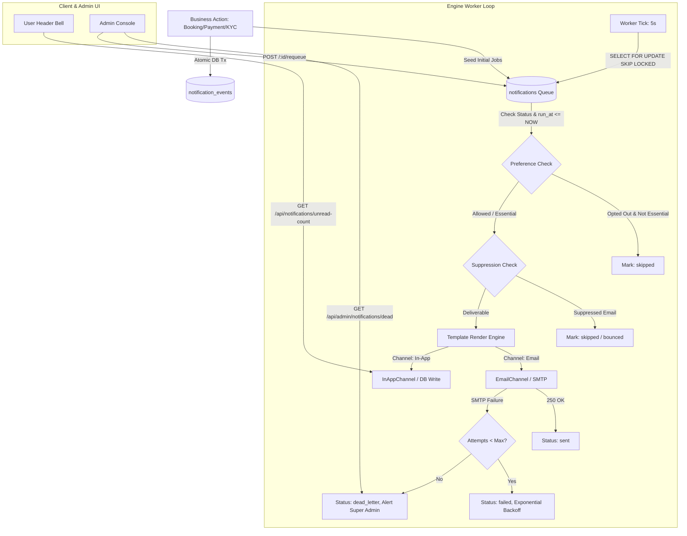

# Implementation Plan — Batch 11: Notification Engine

**Document Identifier**: `2026-10-27_1500_implementation-plan_batch11-notification-engine.md`  
**Date**: 2026-10-27  
**Module**: Batch 11 — Unified Notification Engine & Outbox Dispatcher  
**Status**: Proposed (Awaiting User Review & Approval Block Sign-Off)  
**Dependencies**: Batch 4 (KYC decisions), Batch 5 (Email foundation & Mailpit), Batch 6 (Payments), Batch 7 (Gifting), Batch 8 (Catalog moderation), Batch 9 (Bookings & appointments), Batch 10 (Admin console & RBAC)  
**Feeds Into**: Batch 12 (Production hardening, deliverability, monitoring, and go-live gate)  

---

## 1. Approval Block

```
================================================================================
APPROVAL BLOCK
Status: APPROVED
Reviewer: USER
Decision: Approved: proceed - revision 1
Revision: 1
Date: 2026-10-27
================================================================================
```

---

## 2. Purpose & Executive Summary

By Batch 10, the ODS Global Network produces dozens of business and operational events:
- Merchant & Provider KYC accreditation decisions (Batch 4)
- Account credentials, email verifications, and password recovery (Batch 5)
- Payment receipts, invoice settlement, and refunds (Batch 6)
- Gift voucher purchases, claims, and delivery scheduling (Batch 7)
- Healthcare service publishing moderation and takedown alerts (Batch 8)
- Appointment scheduling, hold timers, confirmations, reschedules, and cancellations (Batch 9)
- Administrative actions, suspensions, staff provisioning, and dual-authorization refund requests (Batch 10)

Historically, these events were either silent or relied on disparate direct email calls. **Batch 11 replaces all scattered sending with a unified, resilient, event-driven Notification Engine**:
1. **Centralized Intake (`notify`)**: Business logic records an atomic transactional event in `notification_events`. Business transactions never block or fail if an external notification channel is slow or unavailable.
2. **PostgreSQL-Backed Worker Queue**: High-throughput concurrency safety using `SELECT ... FOR UPDATE SKIP LOCKED` without requiring Redis or extra server daemons.
3. **Multi-Channel Architecture**: Primary **Email** channel (SMTP via Mailpit in dev, configurable for production SES/SendGrid in Batch 12) + **In-App Notification Center** (bell icon, unread counter badge, dropdown, dedicated page).
4. **Brand-Aligned, Escaped Templating**: Versioned templates in DB (`notification_templates` & `notification_template_versions`) seeded from file defaults, HTML-escaped variable rendering, and brand-consistent responsive styling.
5. **Scheduled Notifications**: Resilient background scheduling for booking reminders (24h and 1h prior), scheduled gift voucher delivery dates, and voucher expiry warnings (7d and 1d prior), with automatic cancellation on reschedule/cancel.
6. **User Preferences & Suppression**: Granular category opt-in/opt-out with non-negotiable security/transactional delivery, signed one-click unsubscription tokens, and bounce/spam suppression lists.
7. **Operational Governance**: Full admin delivery logs, attempt history, dead-letter triage (requeue/discard), template variable preview, and test send capabilities.

---

## 3. Scope Traceability & Non-Goals

### In-Scope Deliverables
* **Database Schema (Migration 023)**: `notification_events`, `notifications`, `notification_templates`, `notification_template_versions`, `notification_preferences`, `notification_suppressions`, and `notification_attempts`.
* **Database Least Privilege**: `ods_app` granted `SELECT, INSERT` on ledger tables; `UPDATE` on queue state; engine-level immutability preserved.
* **Unified Event Dispatcher**: Core `notify(eventType, payload, options, client)` function integrated into existing business logic.
* **Worker & Scheduler**: Dual-loop worker polling pending jobs with exponential backoff retries, dead-letter transitions, and scheduled reminder sweepers.
* **Template Engine**: Secure Mustache/Handlebars-style interpolation with HTML escaping, formatting helpers for ETB currency and Ethiopia timezone (`Africa/Addis_Ababa`).
* **Direct Mail Call Migration**: Cleanly deprecate scattered `mailService.send...` calls in favor of asynchronous notification events; zero direct send calls remaining across feature modules.
* **In-App Center**: REST endpoints + Header notification bell, live unread counter badge, notification drawer, and preferences manager.
* **Admin Backplane**: Integrated into Admin Console (Batch 10) for notification ledger querying, dead-letter retries, template version preview, and delivery health metrics.
* **Automated Verification**: End-to-end suite `Backend/test-batch11-endpoints.js` validating transactions, idempotency, retry backoffs, scheduling, and preference gates.

### Non-Goals (Explicitly Deferred)
* **SMS & Push Channel Implementations**: Interface `NotificationChannel` defined in code, but live SMS gateway integration is deferred to Batch 12 / post-launch.
* **Marketing & Bulk Campaign Mailings**: Platform only handles transactional, operational, and lifecycle notifications.
* **Visual Drag-and-Drop Template Builder**: Templates use standard, clean HTML/CSS with variable bindings.
* **Full Multi-Language Catalog**: Schema includes `locale VARCHAR(10) DEFAULT 'en'`; English ships first, Amharic localization hooks preserved for future phases.
* **Production SMTP & DNS Authentication**: SPF, DKIM, DMARC, and production SES/Resend credentials deferred to Batch 12 Go-Live Gate.

---

## 4. Open Architectural Decisions & Recommendations

| # | Topic | Options | Recommendation & Rationale |
| :--- | :--- | :--- | :--- |
| **1** | **Queue Engine** | PostgreSQL Queue vs. Redis/BullMQ | **PostgreSQL Queue (`FOR UPDATE SKIP LOCKED`)**: Preserves the existing zero-dependency architecture. Highly reliable, transactionally atomic with business data, and zero operational overhead. |
| **2** | **Worker Deployment** | In-process timer vs. Dedicated CLI process | **Dual-Mode**: In-process background timer during local development for ease of use; standalone worker CLI script (`node src/workers/notificationWorker.js`) supported for production deployment. |
| **3** | **Template Storage** | File-based vs. Database-backed | **Hybrid (Recommended)**: File-based defaults versioned in source control that are seeded into PostgreSQL tables (`notification_templates` & `notification_template_versions`). Allows runtime admin edits while guaranteeing safe defaults. |
| **4** | **Language Support** | English only vs. English + Amharic | **English First (`en`) with Locale Column**: Default to `en` with full schema support for `locale`. Preserves architectural readiness for Amharic templates without delaying core engine delivery. |
| **5** | **SMS Gateway** | Launch requirement vs. Deferred | **Deferred to Batch 12**: Design clean channel abstraction (`NotificationChannel` interface) with mock/log SMS driver for dev; connect real SMS API when telco aggregator contract is finalized. |
| **6** | **Welcome & Security Emails** | Include vs. Skip | **Include**: Send warm welcome on email verification completion; alert email on password change (already active from Batch 5). |
| **7** | **Reminder Schedule** | Timing parameters | **Confirmed**: Bookings: 24h & 1h prior; Gift cards: 7 days & 1 day prior to expiration; Stored in `platform_settings`. |
| **8** | **Action Nudges** | Provider acceptance & KYC incomplete | **Include**: Provider unaccepted booking nudge (2h after hold); KYC applicant incomplete nudge (7 days after info requested). |
| **9** | **Admin Alert Routing** | Email to all vs. Permission-scoped | **Permission-Scoped**: Route admin alerts dynamically to active staff possessing the matching Batch 10 permission (`compliance.kyc.review`, `finance.refunds.authorize`, `system.platform.settings`). |
| **10** | **Message Body Storage** | Store rendered HTML vs. Render on-demand | **Render on Demand + Truncated Summary**: Avoid database bloat and PII leakage by storing event payload + template version ID, re-rendering on demand for audit inspection. |
| **11** | **Retention Periods** | Storage lifespan | **In-App**: 90 days; **Sent Logs**: 180 days; **Dead-Letter**: Retained until admin triage; automated daily cleanup sweeper. |
| **12** | **In-App Delivery** | Polling vs. WebSockets / SSE | **Smart Polling (30s interval + window focus)**: Lightweight, robust on mobile networks, and requires zero stateful socket cluster management. |
| **13** | **Production Mail Provider** | Decide now vs. Batch 12 | **Batch 12**: Keep standard SMTP transport interface; Mailpit in dev; switch environment variables to production provider in Batch 12. |
| **14** | **Gift Recipient Content** | Sender message & text rules | **Sanitized & Escaped**: Display sender name and message with strict HTML escaping and 500-char length limits; voucher codes sent as secure claim URLs. |
| **15** | **Sender Identities** | From/Reply-To configurations | **Configurable Identities**: <br>• Default: `ODS Global Network <no-reply@odsglobal.net>`<br>• Support: `ODS Support <support@odsglobal.net>`<br>• Billing: `ODS Billing <billing@odsglobal.net>` |

---

## 5. Event Catalog & Module Integration

| Domain | Event Type (`event_type`) | Trigger Source | Recipient(s) | Default Channels | Category | Priority |
| :--- | :--- | :--- | :--- | :--- | :--- | :--- |
| **Auth & Account** | `account.verify_email` | Registration / Resend | User email | Email | Security / Essential | High |
| | `account.welcome` | Email verified | User | Email, In-App | Informational | Medium |
| | `account.password_reset` | Forgot password | User email | Email | Security / Essential | Critical |
| | `account.password_changed` | Password update | User | Email, In-App | Security / Essential | Critical |
| **KYC & Onboarding** | `kyc.submitted` | Merchant/Provider registration | Admins (`compliance.kyc.review`) | In-App, Email | Operational | Medium |
| | `kyc.approved` | Admin approval | Entity owner | Email, In-App | Status / Essential | High |
| | `kyc.rejected` | Admin rejection (with reason) | Entity owner | Email, In-App | Status / Essential | High |
| | `kyc.more_info_requested` | Admin request info | Entity owner | Email, In-App | Status / Essential | High |
| | `partner.inquiry_received` | `/partner-with-us` submit | Submitter + Support staff | Email, In-App | Operational | Low |
| **Services Catalog** | `service.submitted` | Provider submits for review | Admins (`catalog.services.moderate`) | In-App | Operational | Low |
| | `service.approved` | Admin approves service | Service owner | Email, In-App | Status | Medium |
| | `service.rejected` | Admin rejects service (reason) | Service owner | Email, In-App | Status | Medium |
| | `service.taken_down` | Admin takedown (impact warning) | Service owner | Email, In-App | Status / Essential | High |
| **Payments** | `payment.succeeded` | Chapa webhook completed | Payer (+ Provider) | Email, In-App | Receipts / Essential | High |
| | `payment.failed` | Chapa webhook failed | Payer | Email, In-App | Financial / Essential | High |
| | `refund.completed` | Admin/Provider refund | Customer | Email, In-App | Receipts / Essential | High |
| | `refund.approval_required` | Refund > 10,000 ETB | Admins (`finance.refunds.authorize`) | In-App, Email | Operational | High |
| **Gifts** | `gift.purchased` | Gift order confirmed | Sender | Email, In-App | Receipts / Essential | High |
| | `gift.delivered` | Scheduled delivery triggered | Recipient | Email | Essential | High |
| | `gift.redeemed` | Voucher claimed into wallet | Sender | In-App, Email | Informational | Medium |
| | `gift.expiry_warning` | 7d & 1d before expiry | Recipient / Sender | Email, In-App | Updates | Medium |
| **Bookings** | `booking.confirmed` | Payment settled | Customer & Provider | Email, In-App | Bookings / Essential | Critical |
| | `booking.cancelled` | Cancelled by either side | Customer & Provider | Email, In-App | Bookings / Essential | High |
| | `booking.rescheduled` | Appointment rescheduled | Customer & Provider | Email, In-App | Bookings / Essential | High |
| | `booking.reminder_24h` | 24 hours prior to slot | Customer & Provider | Email, In-App | Reminders | Medium |
| | `booking.reminder_1h` | 1 hour prior to slot | Customer & Provider | Email, In-App | Reminders | High |
| | `booking.payment_conflict` | Late webhook after expiry | Customer & Support staff | Email, In-App | Operational / Essential | Critical |
| **Admin & System** | `user.suspended` | Admin suspends user | Affected user | Email | Security / Essential | Critical |
| | `user.reactivated` | Admin reactivates user | Affected user | Email, In-App | Security / Essential | High |
| | `staff.provisioned` | Super admin creates staff | Staff email | Email | Security / Essential | Critical |
| | `system.dead_letter_alert` | Failed jobs > threshold | Super Admins (`system.platform.settings`)| Email, In-App | System / Essential | Critical |

---

## 6. Database Schema Design (Migration 023)

### Tables to Create:
1. **`notification_events`**: Immutable audit record of emitted events.
   * `id UUID PRIMARY KEY DEFAULT gen_random_uuid()`
   * `event_type VARCHAR(80) NOT NULL`
   * `subject_type VARCHAR(50) NOT NULL` (`user`, `booking`, `gift`, `service`, `kyc`, `payment`)
   * `subject_id VARCHAR(100) NOT NULL`
   * `actor_user_id UUID REFERENCES users(id) ON DELETE SET NULL`
   * `payload JSONB NOT NULL DEFAULT '{}'`
   * `idempotency_key VARCHAR(150) UNIQUE NOT NULL`
   * `created_at TIMESTAMPTZ NOT NULL DEFAULT NOW()`

2. **`notifications`**: The actual outbound channel delivery jobs.
   * `id UUID PRIMARY KEY DEFAULT gen_random_uuid()`
   * `event_id UUID NOT NULL REFERENCES notification_events(id) ON DELETE CASCADE`
   * `recipient_user_id UUID REFERENCES users(id) ON DELETE CASCADE` (nullable for guest gifts)
   * `recipient_address VARCHAR(255) NOT NULL` (email address or user UUID)
   * `channel VARCHAR(20) NOT NULL` (`email`, `in_app`, `sms`)
   * `category VARCHAR(50) NOT NULL` (`security`, `bookings`, `payments`, `gifts`, `kyc`, `updates`)
   * `template_key VARCHAR(80) NOT NULL`
   * `template_version INT NOT NULL DEFAULT 1`
   * `locale VARCHAR(10) NOT NULL DEFAULT 'en'`
   * `status VARCHAR(20) NOT NULL DEFAULT 'pending'` (`pending`, `processing`, `sent`, `failed`, `skipped`, `dead_letter`)
   * `attempts INT NOT NULL DEFAULT 0`
   * `max_attempts INT NOT NULL DEFAULT 4`
   * `run_at TIMESTAMPTZ NOT NULL DEFAULT NOW()` (used for delayed/scheduled jobs)
   * `next_attempt_at TIMESTAMPTZ NOT NULL DEFAULT NOW()`
   * `sent_at TIMESTAMPTZ`
   * `read_at TIMESTAMPTZ` (for `in_app`)
   * `last_error TEXT`
   * `provider_message_id VARCHAR(255)`
   * `created_at TIMESTAMPTZ NOT NULL DEFAULT NOW()`
   * `updated_at TIMESTAMPTZ NOT NULL DEFAULT NOW()`

3. **`notification_templates`** & **`notification_template_versions`**:
   * Versioned email subjects, HTML bodies, and plain-text fallback templates.
   * `is_essential BOOLEAN NOT NULL DEFAULT FALSE` (essential messages cannot be opted out of).

4. **`notification_preferences`**:
   * User opt-in/opt-out matrix per category and channel (`user_id`, `category`, `channel`, `enabled`, `updated_at`).

5. **`notification_suppressions`**:
   * Bounced or complained email addresses blocked from future sending (`address`, `reason`, `created_at`).

6. **`notification_attempts`**:
   * Append-only history ledger tracking every delivery attempt with latency and provider status codes.

### Database Privileges (`ods_app`):
* `SELECT, INSERT` on `notification_events`, `notification_attempts`.
* `SELECT, INSERT, UPDATE` on `notifications`, `notification_preferences`, `notification_suppressions`, `notification_templates`, `notification_template_versions`.
* `DELETE` strictly **denied** on all notification tables to preserve immutable delivery audits.

---

## 7. Architecture & Component Workflow



---

## 8. Implementation Phases

### Phase 1: Database Foundations & Migration 023
- Author `Backend/src/database/migrations/023_create_notification_engine_tables.sql` and `rollback_023.sql`.
- Establish tables, foreign keys, unique partial indexes (`idx_notifications_worker_claim`), and explicit grants for `ods_app`.
- Verify migration execution and least-privilege permission denials (`DELETE` rejected).

### Phase 2: Core Notification Service & Event Catalog
- Author `Backend/src/services/notificationService.js`:
  - `notify(eventType, payload, options, client)`: Atomic event insertion and job enqueueing within the calling transaction.
  - Recipient resolution logic (Customer, Provider, Admin Permission Group).
  - Idempotency key generation: `sha256(eventType:subjectId:recipient:channel:runAt)`.
- Author `Backend/src/services/notificationCatalog.js`: Registry defining all event rules, channels, priority, and default templates.

### Phase 3: Template Store & Interpolation Engine
- Author `Backend/src/services/notificationTemplateService.js`:
  - File-based default templates loaded from `Backend/src/templates/notifications/`.
  - Database seeder initializing `notification_templates` and active versions.
  - Brand HTML wrapper with ODS Global Net luxury navy/gold design tokens and responsive email layout.
  - HTML escaping, variable validation, ETB currency formatter, and Addis Ababa timezone formatting.

### Phase 4: Queue Worker & Reliable Delivery Machine
- Author `Backend/src/workers/notificationWorker.js`:
  - Worker loop claiming jobs via `SELECT id FROM notifications WHERE status IN ('pending', 'failed') AND next_attempt_at <= NOW() AND run_at <= NOW() LIMIT 10 FOR UPDATE SKIP LOCKED`.
  - Channel implementations: `EmailChannel` (via existing Mailpit connection) and `InAppChannel`.
  - Exponential backoff calculation: `1m, 5m, 30m, 2h` before marking `dead_letter`.
  - Integration with server startup (`Backend/src/server.js`) with graceful shutdown handlers.

### Phase 5: Migration of Existing Email Calls
- Refactor Batch 5 verification & password reset routes to emit `account.verify_email` and `account.password_reset` through `notify()`.
- Refactor Batch 4 KYC decision controller to emit `kyc.approved`, `kyc.rejected`, and `kyc.more_info_requested`.
- Refactor Batch 6 payment webhooks to emit `payment.succeeded` and `refund.completed`.
- Refactor Batch 7 gift vouchers to emit `gift.purchased`, `gift.delivered`, and `gift.redeemed`.
- Refactor Batch 8 catalog moderation to emit `service.approved`, `service.rejected`, and `service.taken_down`.
- Refactor Batch 9 booking appointments to emit `booking.confirmed`, `booking.cancelled`, and schedule reminders.
- Repository-wide audit ensuring zero direct external mail invocations outside `notificationWorker.js`.

### Phase 6: Scheduled Lifecycle Notifications & Sweeper
- Author `Backend/src/services/notificationScheduler.js`:
  - Enqueue `booking.reminder_24h` and `booking.reminder_1h` when booking transitions to `confirmed`.
  - Enqueue `gift.delivered` for future `scheduled_delivery_date`.
  - Enqueue `gift.expiry_warning` 7 days and 1 day prior to expiration.
  - Rescheduling/Cancellation hooks: Automatically cancel or recalculate pending reminders in the same transaction.

### Phase 7: User Preferences, Unsubscribe & Suppression
- Author user preferences API: `GET /api/notifications/preferences` and `PUT /api/notifications/preferences`.
- Author unsigned/signed token one-click unsubscribe endpoint: `GET /api/notifications/unsubscribe?token=...`.
- Enforcement at worker send time: Suppress optional notifications if user opted out; guarantee delivery for essential security/transactional categories.

### Phase 8: In-App Notification Center API & Real-Time Sync
- Author in-app endpoints in `Backend/src/routes/notifications.js`:
  - `GET /api/notifications`: Paginated in-app feed with read/unread filtering.
  - `GET /api/notifications/unread-count`: Lightweight counter for header badge.
  - `POST /api/notifications/:id/read` & `POST /api/notifications/read-all`.
  - Retention sweeper purging read items older than 90 days.

### Phase 9: Admin Console Notification Management Hub
- Author `Backend/src/routes/adminNotifications.js` with Batch 10 RBAC permissions:
  - `GET /api/admin/notifications`: Search/filter notification log.
  - `GET /api/admin/notifications/dead`: Dead-letter queue inspection.
  - `POST /api/admin/notifications/:id/requeue`: Re-try dead letter job.
  - `POST /api/admin/notifications/:id/discard`: Permanently cancel dead job.
  - `GET /api/admin/notification-templates`: Version inspection, preview, and test send.
  - All admin mutations strictly audited to `admin_audit_log`.

### Phase 10: Frontend Implementation
- **Header Bell & Counter**: In [`Frontend/src/components/layout/Header.tsx`](file:///d:/Ods%20Global/Source%20Code/Ods-Global-Network/Frontend/src/components/layout/Header.tsx), add interactive bell icon with unread count badge and quick dropdown.
- **In-App Notification Feed**: Build `Frontend/src/pages/NotificationsPage.tsx` with filter tabs, read toggles, and direct links.
- **User Preferences Tab**: Add Notification Preferences tab to Customer & Provider dashboards.
- **Admin Console Extension**: Add **Notifications Hub** tab to [`AdminDashboard.tsx`](file:///d:/Ods%20Global/Source%20Code/Ods-Global-Network/Frontend/src/pages/dashboards/AdminDashboard.tsx) (delivery logs, dead-letter triage, and template preview).

### Phase 11: Comprehensive Test Suite & Regression Verification
- Author `Backend/test-batch11-endpoints.js`:
  - Test transactional rollback integrity (no orphan events on failed DB commit).
  - Test worker concurrency (2 workers racing for the same job with `SKIP LOCKED`).
  - Test idempotency (duplicate events produce single email dispatch).
  - Test SMTP retry backoff and dead-letter queue escalation.
  - Test booking reminder cancellation on appointment reschedule.
  - Test user opt-out preference enforcement and essential category bypass.
- Execute full regression across Batches 3, 4, 5, 6, 7, 8, 9, 10.
- Execute Frontend production build (`npm run build`).

---

## 9. Rollback Plan

If any critical defect or migration failure occurs during Batch 11 rollout:
1. **Database Rollback**:
   * Execute `Backend/src/database/rollbacks/rollback_023.sql` to drop `notification_attempts`, `notifications`, `notification_events`, `notification_templates`, `notification_template_versions`, `notification_preferences`, and `notification_suppressions`.
2. **Code Rollback**:
   * Git revert back to commit `fca1bba` (Batch 10 verified sign-off).
3. **Application Decoupling**:
   * Existing Batch 5 mail utilities remain intact as fallback transports if emergency direct email sending is required.

---

## 10. File Inventory (In-Scope Files)

### New Files to Create:
* `Backend/src/database/migrations/023_create_notification_engine_tables.sql`
* `Backend/src/database/rollbacks/rollback_023.sql`
* `Backend/src/services/notificationService.js`
* `Backend/src/services/notificationCatalog.js`
* `Backend/src/services/notificationTemplateService.js`
* `Backend/src/services/notificationScheduler.js`
* `Backend/src/workers/notificationWorker.js`
* `Backend/src/routes/notifications.js`
* `Backend/src/routes/adminNotifications.js`
* `Backend/src/templates/notifications/*.html` (Default templates)
* `Backend/test-batch11-endpoints.js`
* `Frontend/src/pages/NotificationsPage.tsx`
* `Frontend/src/pages/dashboards/admin/NotificationsHubTab.tsx`
* `Frontend/src/pages/dashboards/customer/NotificationPreferencesTab.tsx`
* `Frontend/src/services/notificationService.ts`

### Existing Files to Modify:
* `Backend/src/server.js` (Mount notification routes and initialize worker)
* `Backend/src/routes/auth.js` (Migrate verify & password reset to `notify()`)
* `Backend/src/routes/admin.js` & `Backend/src/services/kycService.js` (Migrate KYC decisions)
* `Backend/src/routes/payments.js` (Migrate payment & refund receipts)
* `Backend/src/routes/gifting.js` (Migrate voucher notifications)
* `Backend/src/routes/bookings.js` (Migrate booking confirmation & schedule reminders)
* `Frontend/src/components/layout/Header.tsx` (Add notification bell & dropdown)
* `Frontend/src/pages/dashboards/AdminDashboard.tsx` (Add Notifications Hub sidebar item)
* `Frontend/src/pages/dashboards/CustomerDashboard.tsx` (Add preferences tab)
* `Status/PROJECT_STATUS.md` (Update progress tracking)

---

## 11. Revision Log

* **Revision 1 (2026-10-27)**: Initial comprehensive implementation plan drafted from user specifications and system architecture directives.
