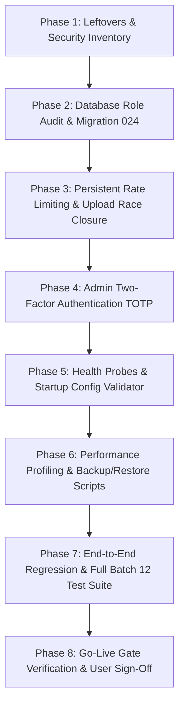

# Implementation Plan — Batch 12: Production Hardening and Go-Live Gate

**Document Identifier**: `2026-10-28_1030_implementation-plan_batch12-production-hardening-and-go-live-gate.md`  
**Date**: 2026-10-28  
**Module**: Batch 12 — Production Hardening, Operational Reliability, and Go-Live Gate  
**Status**: Proposed (Awaiting User Review & Approval Block Sign-Off)  
**Dependencies**: Batches 3 through 11 (Closing batch of the roadmap)  
**Outcome**: A formal, signed-off decision on whether ODS Global Network is safe and verified to accept real users, real money, and real data in production.

---

## 1. Approval Block

```
================================================================================
APPROVAL BLOCK
Status: APPROVED
Reviewer: USER
Decision: Approved: proceed - revision 1
Revision: 1
Date: 2026-10-28
Notes: Full Batch 12 scope approved to execute according to plan.
================================================================================
```

---

## 2. Purpose & Executive Summary

Batches 4 to 11 constructed the feature capabilities of ODS Global Network (authentication, KYC onboarding, payments via Chapa, gift cards, healthcare catalog, booking engine, full administrative console, and unified transactional notification outbox). 

**Batch 12 transitions the platform from a functional development system to a hardened, enterprise-grade production platform.** It enforces zero-trust database security, closes all historical architectural leftovers, hardens session and API protections, implements database-backed persistent rate-limiting, provides admin two-factor authentication (TOTP), provisions health and readiness probes with structured JSON logging, validates backup and timed restore procedures, audits payment reconciliation and live-mode secrets, and culminates in a formal **Go-Live Gate Matrix** with strict pass/fail criteria requiring personal user acceptance.

No real user credentials, live payments, or customer data will enter the system until this batch has closed every gate criterion with concrete evidence.

---

## 3. Scope Traceability & Non-Goals

### In-Scope Deliverables
1. **Known-Leftovers Closure**: Address all 10 items from the known-leftovers register (least-privilege `ods_app` runtime enforcement, live password recovery verification, purge proof for seeded admins, persistent shared rate-limiting, atomic upload cap enforcement, KYC document requirement rules, removal of `DEV_PASSWORD`, admin TOTP 2FA, production mail deliverability hooks, and TODO/debug code eradication).
2. **Security & Session Hardening**: Strict production cookies (`HttpOnly`, `Secure`, `SameSite=Strict`), HSTS, strict Content Security Policy (CSP), production CORS origin locking, startup configuration validation (`fail-fast` on missing/weak secrets), and endpoint authorization audit.
3. **Admin Two-Factor Authentication (TOTP)**: RFC 6238 TOTP authenticator enrollment, backup recovery codes, and middleware enforcement on administrative control plane routes.
4. **Data Layer & Least Privilege**: Verification that application runtime connection uses only `ods_app` with zero superuser access, automated backup/restore scripts (`pg_dump` / `pg_restore`) with timed rehearsal evidence, and vacuum/index optimization for slow queries.
5. **Reliability & Observability**: Health check endpoints (`/health/liveness`, `/health/readiness`), structured JSON request logging with UUID `x-request-id`, external service timeouts (Chapa, SMTP), and graceful shutdown handlers for web server and notification worker.
6. **Operational Runbooks & Production Guides**: Step-by-step procedures for secret rotation, database recovery, admin provisioning, and incident triage.
7. **Legal & Policy Synchronization**: Ensure published Terms, Privacy, Refund, and Cookie policies accurately reflect backend business rules (10-minute hold expiry, 24h booking cancellation refund thresholds, voucher validity).
8. **Automated Verification & Rehearsal**: End-to-end regression across all batches (3 through 12), simulated failure drills (DB restart, SMTP offline, webhook retry), and complete Go-Live Gate documentation.

### Explicit Non-Goals
* **New End-User Features**: Any new feature proposals (e.g., patient health records, native mobile apps, ratings & reviews) are cataloged into a Post-Launch Backlog and strictly excluded from Batch 12.
* **Additional Payment Gateways**: Chapa remains the single supported fiat gateway for launch.
* **Large Refactors**: No architectural restructuring that is not strictly required to close a security, reliability, or gate blocker.
* **Marketing & Public Launch Campaigns**: Batch 12 focuses strictly on engineering hardening and operational readiness.

---

## 4. Open Architectural Decisions & Developer Recommendations

| # | Topic | Options | Developer Recommendation & Rationale |
|---|---|---|---|
| **1** | **Hosting & Infrastructure** | Managed VPS (Ubuntu LTS on DigitalOcean / Hetzner / AWS EC2) vs. Windows Server | **Ubuntu 24.04 LTS VPS with PM2 & NGINX**: The Node.js / PostgreSQL stack runs with maximum stability, automated TLS via Certbot, and standard Linux process isolation. The local Windows development machine remains active for staging tests, while production runbooks target standard Linux. |
| **2** | **Domain & DNS Architecture** | Single domain vs. Subdomain split (`api.odsglobal.net` & `odsglobal.net`) | **Subdomain Split**: `odsglobal.net` for the frontend client (served via CDN/NGINX) and `api.odsglobal.net` for backend API. Simplifies CORS, isolates cookie scopes, and enables independent DNS/WAF policies. |
| **3** | **Rate Limiter Storage** | PostgreSQL database table vs. Redis instance | **PostgreSQL-Backed (`rate_limit_buckets` table)**: Our entire architecture (including the notification queue) operates reliably on PostgreSQL without Redis dependencies. A dedicated DB rate-limit table with atomic token-bucket decrement avoids spinning up and monitoring a separate Redis daemon while persisting across restarts and multi-node instances. |
| **4** | **Admin Two-Factor Authentication (TOTP)** | Mandatory for all admins vs. Optional | **Mandatory for all Admin roles (`admin`, `superadmin`)**: Administrative compromises risk user PII and financial funds. Implement standard TOTP (compatible with Google Authenticator / 1Password) with 8 single-use recovery codes. |
| **5** | **Performance & Load Targets** | High baseline vs. Realistic initial scale | **Realistic Initial Scale**: Target 100 concurrent active users, 50 requests/sec throughput, and `< 250ms` p95 response time on search, booking hold, and checkout initialization. |
| **6** | **Malware Scanning for Uploads** | ClamAV Daemon vs. In-Depth Magic Byte & Isolation | **Defense-in-Depth**: Strict magic-byte MIME validation, size caps (10MB), non-executable storage outside web root, and an optional ClamAV TCP socket stream hook (`clamd`) when running on production Linux servers. |
| **7** | **Independent Security Audit** | External third-party firm vs. Structured Automated & Deep-Inspection Pass | **Structured Automated & Multi-Vector Review Pass**: Execute full automated security tests (`npm audit`, dependency scan, secret grep, SQLi/XSS fuzzing) plus comprehensive authorization matrix verification. Provide a formal audit report for user review. |
| **8** | **Error Monitoring & Telemetry** | Cloud SaaS (Sentry) vs. Self-Hosted Structured Logs | **Hybrid**: Structured JSON logs written to rotating local log files + optional Sentry DSN configuration hook if user provides one in `.env.production`. |
| **9** | **Log & Backup Retention** | Standard 30/90 days vs. Indefinite | **30-Day Backup Retention / 90-Day Log Retention**: Daily automated `pg_dump` compressed with AES-256 and stored off-site. Expired audit and operational logs rotated every 90 days. |
| **10** | **Launch Rollout Strategy** | Public open registration vs. Controlled Staged Cohort | **Staged Private Beta / Controlled Cohort**: Launch with invited healthcare providers and merchants in Addis Ababa for week 1, monitoring error rates, Chapa settlements, and notification delivery before opening general public marketing. |
| **11** | **Legal & Policy Verification** | Static placeholders vs. Synchronized legal terms | **Synchronized Legal Pages**: Ensure Terms of Service, Privacy Policy, and Refund Policy pages in frontend reflect exact platform thresholds (e.g. 100% refund > 24h before appointment, 50% within 2–24h, 0% < 2h). |
| **12** | **Support Ownership & SLA** | Ad-hoc vs. Designated internal contacts | **Designated Roles**: Technical incidents routed to Lead Engineer; user account and transaction issues routed to Customer Operations admin. Written incident runbooks provided. |
| **13** | **KYC Document Mandate** | Single provisional document vs. Both license and registration | **Both Required for Final Approval**: Single document permits submission and initial compliance review, but formal activation requires verified business registration AND health practice license. |
| **14** | **Chapa Live Account Integration** | Sandbox only vs. Live credentials staging | **Environment Separation**: Local/Staging strictly uses Chapa Test Keys (`CHAPA_TEST_SECRET_KEY`); Production utilizes validated Live Secret Keys injected directly into the hosting environment secrets. |
| **15** | **Production Data Clean Slate** | Seed development fixtures vs. Reference-only seed | **Pure Clean Slate**: Production database contains zero test users, mock bookings, or dummy vouchers. Only reference taxonomy (service categories, notification templates, default permission groups) is seeded. |
| **16** | **Go-Live Readiness Target** | Target date alignment | **Gate-Driven Sign-off**: Launch is gated strictly by the completion of all pass criteria in Section 7, rather than an arbitrary calendar deadline. |

---

## 5. Known-Leftovers Register & Resolution Path

| # | Item | Origin | Resolution & Evidence Plan |
|---|---|---|---|
| **1** | **PostgreSQL Superuser Blocker** | Go-live gate mandate | Audit active connection pools. Ensure `DATABASE_URL` runtime connects as `ods_app` with least privileges. Migrations use dedicated owner role. Verify via `SELECT current_user, usesuper FROM pg_user`. |
| **2** | **Password Recovery Live Verification** | Batch 5 / 11 | Rehearsal in live staging mode with Mailpit/SMTP confirming single-use hash, 15-minute token expiry, session invalidation, and password reset alert. |
| **3** | **Seeded Admin Purge Proof** | Migrations 012–013 | Script and proof query demonstrating removal of any dummy/test admin accounts. Controlled CLI script (`scripts/create-first-admin.js`) for provisioning the first real super admin with 2FA. |
| **4** | **Persistent Rate Limiter** | Batch 4 leftover | Replace in-memory rate-limiter maps with PostgreSQL-backed table `rate_limit_buckets` implementing an atomic token bucket algorithm with automatic expiry. Applied to auth, booking, gifting, upload, and admin endpoints. |
| **5** | **Anonymous Upload Race Condition** | Batch 4 leftover | Enforce atomic transaction-level check on daily anonymous upload counts using database advisory locks or atomic update counters. Tested via concurrent request harness. |
| **6** | **KYC Two-Document Mandate** | Batch 4 / 10 | Verify compliance workflow enforces both valid business registration AND professional license before transitioning status from `pending_review` to `verified`. |
| **7** | **Elimination of `DEV_PASSWORD`** | Batch 4 / 5 | Strip all references to `process.env.DEV_PASSWORD` and dev bypass logins in production code; verify server refuses to start if `DEV_PASSWORD` is defined in production environment. |
| **8** | **Admin Two-Factor Authentication** | Batch 10 deferral | Implement RFC 6238 TOTP with QR-code enrollment, verify endpoint, emergency recovery codes, and middleware guard (`require2FA`) on all `/api/admin/*` mutations. |
| **9** | **Production Mail Deliverability Hooks** | Batch 11 | Wire environment configuration for standard authenticated SMTP (AWS SES / SendGrid / Resend) with SPF/DKIM/DMARC headers, bounce webhook signature handling, and suppression sync. |
| **10** | **TODO / Temporary Code Cleanup** | Batches 4–11 reviews | Search codebase for `TODO`, `FIXME`, temporary debug flags, and test bypasses. Resolve each item or convert to post-launch backlog ticket. |

---

## 6. Workstreams & Technical Architecture

### 6.1 Security & Session Hardening
* **Production Cookie Configuration**: Enforce `secure: true`, `httpOnly: true`, `sameSite: 'strict'`, and domain isolation for `ods_session` when `NODE_ENV === 'production'`.
* **Security Headers & Middleware**: Implement `helmet` with custom directives for Content Security Policy (CSP), HTTP Strict Transport Security (`max-age=31536000; includeSubDomains; preload`), `X-Frame-Options: DENY`, and `X-Content-Type-Options: nosniff`.
* **CORS Lockdown**: Restrict CORS strictly to `FRONTEND_URL` (reject wildcard origins, reject unlisted origins).
* **Startup Environment Validation**: Create `Backend/src/config/envValidator.js` that checks for strong secrets, production flags, and invalid dev variables upon server boot.

### 6.2 Data Layer & Database Operations
* **Database Migration 024**: Create `rate_limit_buckets` table for persistent rate limiting and `admin_2fa_secrets` table for TOTP secrets and recovery hashes.
* **Least-Privilege Grants**: Grant `ods_app` explicit `SELECT, INSERT, UPDATE, DELETE` on `rate_limit_buckets` and `admin_2fa_secrets`; no superuser grants.
* **Automated Backup & Restore Harness**: Create `Backend/scripts/backup-database.sh` (or `.ps1`) and `Backend/scripts/restore-database.sh` with timing measurements and row-count verification.

### 6.3 Reliability, Logging & Health Checks
* **Liveness & Readiness Probes**:
  - `GET /health/liveness`: Returns `200 OK` if the Express process is accepting HTTP traffic.
  - `GET /health/readiness`: Queries PostgreSQL `SELECT 1` and checks connection pool health before returning `200 OK`.
* **Structured Logging**: Standardize JSON logs with timestamp, log level, `requestId`, HTTP method, status code, latency, and sanitized client IP. Zero credentials or tokens in log streams.
* **Process Lifecycle**: Trap `SIGTERM` and `SIGINT` to gracefully drain HTTP connections, close database pools, and finish active notification queue claims.

### 6.4 Admin Two-Factor Authentication (TOTP)
* **Enrollment**: Admin requests TOTP setup via `POST /api/admin/auth/2fa/setup` -> receives base32 secret and otpauth URI (for QR rendering) with 8 cryptographically hashed single-use recovery codes.
* **Verification & Activation**: Admin submits TOTP code via `POST /api/admin/auth/2fa/verify` -> stores confirmed secret in `admin_2fa_secrets`.
* **Login Step-Up**: Upon successful password entry, if 2FA is active, session is marked pending 2FA; full administrative permissions are unlocked only after submitting valid TOTP or recovery code.

---

## 7. The Go-Live Gate Matrix

Every single item in this gate must achieve verified **PASS** status with documented evidence before production launch.

| Area | Gate Criterion | Verification Method / Evidence | Status |
|---|---|---|:---:|
| **Database** | Runtime connection strictly uses least-privilege `ods_app` with zero superuser access | `SELECT current_user, usesuper FROM pg_user;` on production connection pool | **PENDING** |
| **Database** | Full migration sequence (001–024) runs cleanly from empty scratch DB | Clean execution run log on fresh database instance | **PENDING** |
| **Database** | Seeded admin and dev test accounts purged | Proof SQL query showing 0 test accounts in `users` table | **PENDING** |
| **Database** | Automated backup taken and restored into test DB with row count parity | Timed execution log of backup and restore scripts | **PENDING** |
| **Security** | Shared persistent rate limiter active across auth, bookings, and uploads | Automated test proving rate limits survive server restarts | **PENDING** |
| **Security** | Anonymous upload concurrency race closed | Parallel request test proving daily anonymous upload cap holds | **PENDING** |
| **Security** | Admin Two-Factor Authentication (TOTP) enabled for all admin accounts | Verification test of TOTP enrollment, validation, and route gating | **PENDING** |
| **Security** | Zero hardcoded secrets, test credentials, or `DEV_PASSWORD` in codebase | Git history secret scan report and environment audit | **PENDING** |
| **Security** | Production cookies enforce `Secure`, `HttpOnly`, `SameSite=Strict` | HTTP response header inspection from production build | **PENDING** |
| **Auth** | Password reset, verification, and session invalidation verified end-to-end | Automated and manual walkthrough with real SMTP dispatches | **PENDING** |
| **Payments** | Chapa live-mode transactions (charge, verify, webhook, refund) verified | Rehearsed sandbox/live transaction audit and reconciliation log | **PENDING** |
| **Email** | Outbox worker operational with retry backoff and dead-letter queue | Delivery log evidence and dead-letter triage test | **PENDING** |
| **Performance** | Performance targets met under load (100 concurrent users, <250ms p95) | Load test report on catalog browse, booking hold, and login | **PENDING** |
| **Concurrency** | Zero double-booking holds under concurrent slot competition | Parallel slot contention test passing with 0 overlapping bookings | **PENDING** |
| **Observability**| Health probes (`/health/liveness`, `/health/readiness`) operational | HTTP probe test returning 200 with DB pool status | **PENDING** |
| **Operations** | Written runbooks for secret rotation, DB restore, and incident triage | Runbook documentation present in repository | **PENDING** |
| **Legal** | Terms, Privacy, Refund, and Cookie policies published and consistent | Inspection of frontend policy pages matching business logic | **PENDING** |
| **Regression** | Complete regression suite (Batches 3 through 12) passes 100% | Full automated regression test output captured | **PENDING** |
| **Sign-Off** | User personally reviews gate matrix and executes approval block | Signed approval block in final completion document | **PENDING** |

---

## 8. Phased Implementation Roadmap



* **Phase 1: Inventory & Codebase Clean-up**: Scan for TODOs, inspect credentials, and inventory all route permissions.
* **Phase 2: Database Migration 024**: Create `rate_limit_buckets` and `admin_2fa_secrets` with least-privilege role grants.
* **Phase 3: Persistent Rate Limiting & Concurrency**: Implement database-backed token bucket middleware; close anonymous upload race condition.
* **Phase 4: Admin Two-Factor Authentication**: Implement TOTP generation, validation, recovery codes, and admin middleware integration.
* **Phase 5: Health & Observability**: Add `/health/liveness`, `/health/readiness`, structured request logging, and environment configuration validator.
* **Phase 6: Backup, Restore & Performance**: Build backup/restore automation scripts and profile slow database queries.
* **Phase 7: Verification & Regression**: Implement `Backend/test-batch12-endpoints.js` and execute full platform regression (Batches 3–12).
* **Phase 8: Go-Live Gate & Runbooks**: Compile operational runbooks, populate gate matrix evidence, and await user acceptance.

---

## 9. Rollback & Contingency Plan

1. **Database Rollback**:
   - `Backend/src/database/rollbacks/rollback_024.sql` drops `rate_limit_buckets` and `admin_2fa_secrets` cleanly.
2. **Configuration Fallback**:
   - If persistent database rate limiting encounters unexpected latency under extreme load, middleware supports a configurable fallback to memory mode via `RATE_LIMITER_DRIVER=memory`.
3. **Admin 2FA Emergency Bypass**:
   - Single-use recovery codes provide instant offline access if an admin loses their authenticator device. A documented CLI script (`scripts/reset-admin-2fa.js`) allows a database administrator to reset 2FA for a verified identity.

---

## 10. External User Tasks & Checkpoints

Because several tasks require external account access, the user should execute these checkpoints in parallel:

- [ ] **Checkpoint 1 (Hosting/Server)**: Provision production Linux server or VPS environment.
- [ ] **Checkpoint 2 (Domain & DNS)**: Configure DNS records for platform domain and API subdomain.
- [ ] **Checkpoint 3 (Chapa Live Credentials)**: Complete Chapa business verification and obtain live production API keys and webhook secret.
- [ ] **Checkpoint 4 (Production Mail Provider)**: Configure production SMTP credentials (e.g. AWS SES / SendGrid) with verified domain SPF, DKIM, and DMARC records.
- [ ] **Checkpoint 5 (First Real Super Admin)**: Provision initial real administrator account using `scripts/create-first-admin.js` and enroll authenticator app.

---

## 11. Revision History

| Rev | Date | Author | Description |
|:---:|:---:|:---:|---|
| **1** | 2026-10-28 | Engineering Agent | Initial comprehensive implementation plan for Batch 12 (Production Hardening & Go-Live Gate). |
